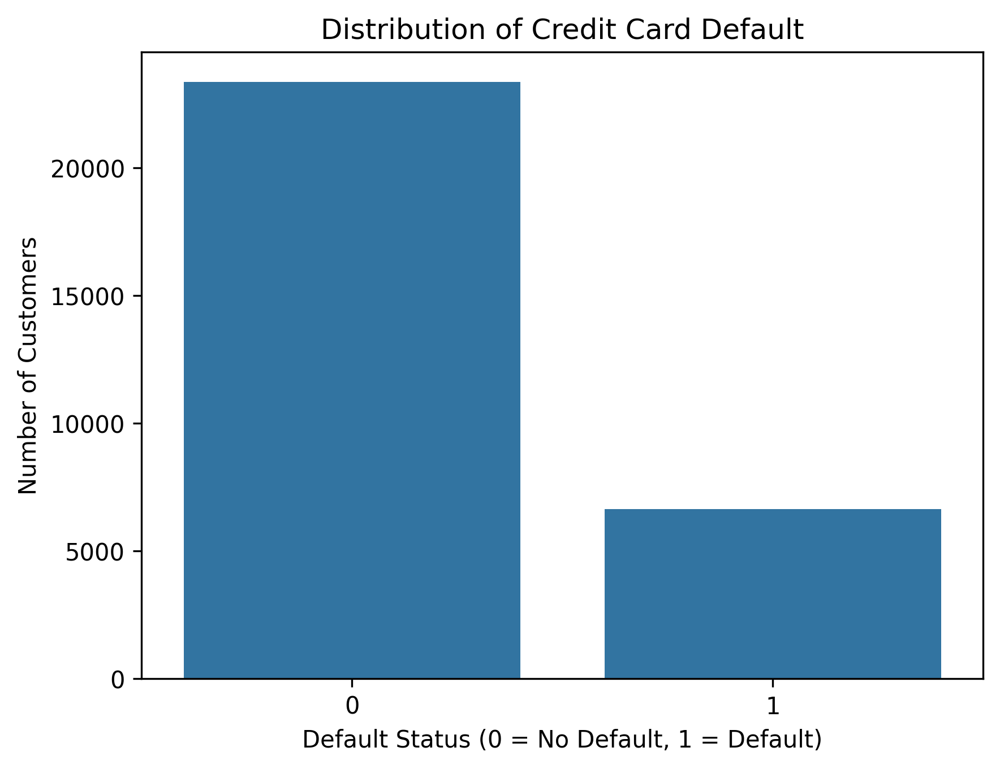
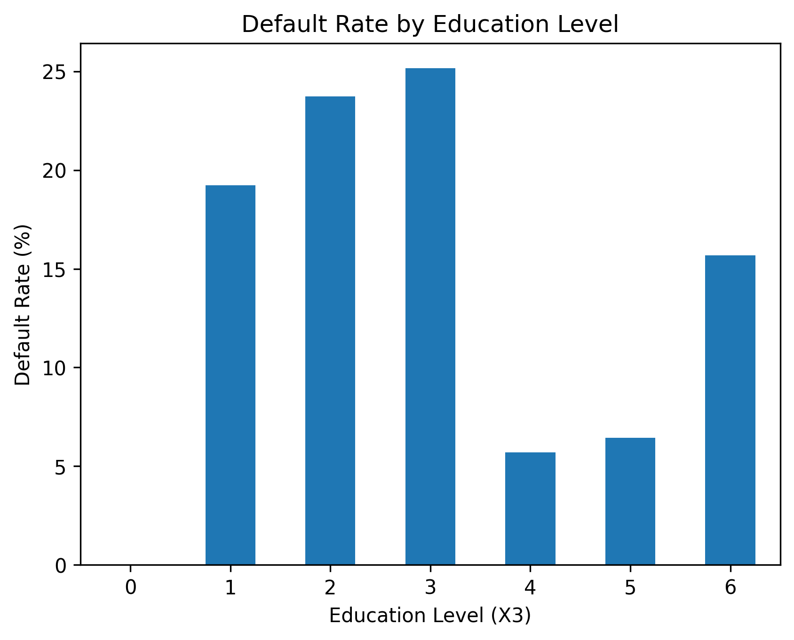
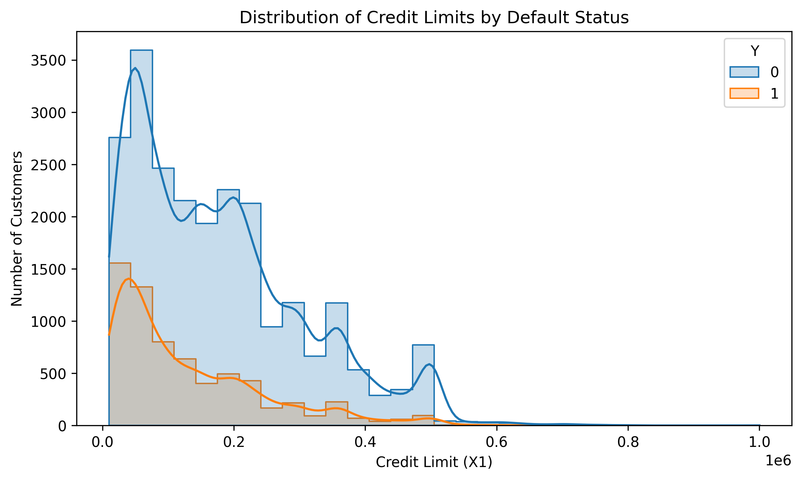

# Credit-Risk-Analysis
Credit risk analysis and default prediction using Python
# Credit Risk Analysis and Default Prediction

## Project Overview

This project explores customer credit behaviour and factors associated with credit card default. Using Python, the analysis investigates demographic characteristics, credit limits, repayment history and payment behaviour to identify patterns associated with default risk.

The project also aims to develop a classification model to predict the likelihood of credit card default.

## Dataset

The project uses the **Default of Credit Card Clients** dataset from the UCI Machine Learning Repository.

- **Observations:** 30,000 customers
- **Explanatory variables:** 23
- **Target variable:** Default status

The target variable, `DEFAULT`, indicates whether a customer defaulted on their payment in the following month:

- `0` – No default
- `1` – Default

**Source:** [UCI Machine Learning Repository](https://archive.ics.uci.edu/dataset/350/default+of+credit+card+clients)

## Tools and Technologies

- Python
- Pandas and NumPy
- Matplotlib and Seaborn
- Scikit-learn (planned for predictive modelling)

## Exploratory Data Analysis

The exploratory analysis examines the distribution of default status, default rates across education categories, and credit limit patterns.

### 1. Distribution of Default Status



The target variable is imbalanced, with more customers who did not default than customers who defaulted. This is an important consideration when developing and evaluating classification models.

### 2. Default Rates by Education



This visualisation compares default rates across education categories to explore potential differences in repayment behaviour.

### 3. Credit Limit Distribution by Default Status



Credit limits are compared across default categories to examine differences in their distributions.

## Predictive Modelling

The next stage will involve developing classification models, beginning with Logistic Regression.

Model performance will be assessed using:

- Accuracy
- Precision
- Recall
- F1-score
- ROC-AUC
- Confusion matrix

Given the class imbalance, particular attention will be paid to precision and recall rather than relying on accuracy alone.

## Limitations

- The dataset represents historical credit card clients in Taiwan and may not generalise to other markets.
- Relationships between variables and default status do not necessarily imply causation.
- The project is for educational and portfolio purposes and is not a validated credit decision-making system.

## Repository Structure

## Repository Structure

```text
Credit-Risk-Analysis/
│
├── images/
│   ├── default_distribution.png
│   ├── default_by_education.png
│   └── credit_limit_distribution.png
│
├── .gitignore
├── README.md
├── credit_risk_analysis.ipynb
└── requirements.txt
```

## Project Status

**In Progress** – Exploratory data analysis completed; predictive modelling and evaluation are the next stages.
